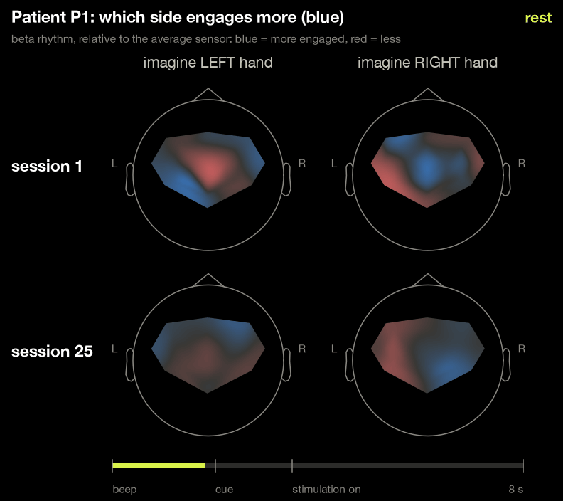

# Is the brain re-learning?

Decoding and describing scalp EEG patterns across two stroke motor-imagery BCI sessions.
Original analysis and animation by Sudip Sharma for the
[BR41N.IO hackathon at IEEE SMC 2026](https://www.gtec.at/hackathon/ieee-smc-2026/),
using the g.tec stroke-rehab dataset. This contribution adds a training-only
mu-power notebook, input checks and more precise interpretation.



**How to read the animation:** colours show beta-power change at scalp sensors,
relative to a pre-cue baseline, with the across-sensor mean subtracted in dB.
Blue is lower relative power; it need not mean an absolute power decrease or
measured cortical activation. Maps use standard electrode positions and
interpolation; colours are clipped at ±2 dB. The original GIF is preserved.
Its engagement/imagery-only labels are shorthand: offline filtering, Hilbert
processing and centred smoothing mix information across time. The animation
cannot establish that displayed early activity preceded actual feedback.

## Research questions

1. How does within-session hand classification compare with the supplied reference results, accounting for different scoring methods?
2. How do timing and measurement assumptions affect classification, and which imagery/cue/feedback explanations remain unresolved?
3. How well does a labelled model transfer between sessions, with PRE→POST reported separately from POST→PRE?
4. Which scalp-power patterns differ between the first and last sessions, without assuming those differences demonstrate recovery?

## The data

Three chronic-stroke participants completed 25 therapy sessions. The release
contains the first (PRE) and last (POST) sessions, each with separate training
and test runs: 16 channels at 256 Hz and 80 held eight-second trial labels
(40 left, 40 right). The cue is at +2 s; documentation places feedback around
+3.5 s, but per-trial feedback timestamps are absent. A full −2 to +8 s epoch
excludes one boundary trial in P1 POST, giving 479 test trials in the original
pipeline. The new mu notebook uses training recordings only.

## Reported decoding results

These are the original reported results, not new scores from this contribution.
Within-session models fit the training run and score the test run. The transfer
column uses labels from the same participant's other session, including that
session's training and test runs; it includes both temporal directions.

| Session | Ref. CSP+LDA | Ref. PCA+TVLDA | Within-session | Other-session transfer |
|---|---|---|---|---|
| P1 pre | 77.1 | 92.9 | 91.2 | 76.2 |
| P1 post | 93.9 | 97.0 | 98.7 | 62.0 |
| P2 pre | 68.4 | 72.4 | 78.8 | 88.8 |
| P2 post | 96.1 | 97.4 | 100.0 | 93.8 |
| P3 pre | 74.4 | 93.6 | 91.2 | 93.8 |
| P3 post | 79.7 | 100.0 | 96.2 | 97.5 |
| **Mean** | 81.6 | 92.2 | **92.7** | 85.3 |


The within-session filter-bank Riemannian model with trial-ordered recentering
reported 444/479 correct (92.7%). Its preprocessing is offline/noncausal;
label-free recentering does not make the complete pipeline online-ready.
The transfer mean is 85.3% across six session cells. PRE→POST alone averages
84.4%, and POST→PRE averages 86.2%; retrospective transfer is not prospective
calibration-free deployment. Reference values use different methods and
aggregation, so similar percentages do not establish equivalence or superiority.

## Physiology and interpretation

The original early post-cue [2, 3.5) s results and lateralisation patterns are
exploratory scalp measurements. They cannot distinguish imagery from
hand-specific cues, feedback, artifacts or measurement assumptions. The
27 band/reference/window variants reuse the same recordings; nine include
feedback, and they are sensitivity checks rather than independent confirmations
of recovery. Lesion sides and clinical outcomes are not supplied.

[The executed mu-power notebook](notebooks/02_mu_power.ipynb) adds a fixed
C3/C4 8–13 Hz task/baseline comparison across all six training runs, using
window-local spectra. It fits no classifier and loads no test recording.
See [methods and reproduction](analysis/mu_power/README.md). It is prepared
with AI assistance; positive/negative dB means more/less power than baseline,
not success/failure or treatment benefit.

## Reproduce

Use Python 3.11 or later. Original environment pins are in `requirements.txt`;
notebook and test tools are in `requirements-dev.txt`.

```sh
python3.11 -m venv .venv
. .venv/bin/activate
python -m pip install -r requirements-dev.txt
scripts/download_data.sh
scripts/run_all.sh
python analysis/mu_power/mu_pass.py --data-dir data/stroke-rehab/stroke-rehab
python -m pytest -q
```

On Windows, activation is `.venv\Scripts\Activate.ps1`. If recordings are
already extracted, set `STROKE_REHAB_DATA` to their folder; the loader accepts
flat and nested organiser layouts. For the mu script, pass that same folder
with `--data-dir`. The notebook also reads `STROKE_REHAB_DATA`.
The shell downloader needs curl and bsdtar; it is not required for existing data.

**Verified for this contribution:** all eight notebook code cells executed;
six synthetic tests passed; the updated loader returns the original samples
and labels for all twelve recordings; all three mu-analysis CSVs match the
previously checked computation. Original figures and result values are retained.
The complete seven-step original pipeline has not been rerun in its exact pinned
environment here. Supplied reproduction scripts are distinct from a verified
end-to-end reproduction of every reported result.

- `src/mi.py`: loading, epoching, feature banks and classifier pipelines.
- `src/benchmark.py`, `adapt.py`: original decoding and transfer comparisons.
- `src/deeper.py`, `robust.py`: early-window, time-resolved and scalp-power analyses.
- `src/figures_*.py`, `animate.py`: original figures and animation.
- `analysis/mu_power/`, `notebooks/02_mu_power.ipynb`: added training-only analysis.
- [Evaluation notes](docs/evaluation-notes.md): fitting scope, timing and uncertainty.

Raw recordings belong to g.tec and are not redistributed. Three participants,
repeated trials and already inspected test results limit clinical/generalisation
claims. Pooled trial confidence intervals do not quantify uncertainty for new patients.
